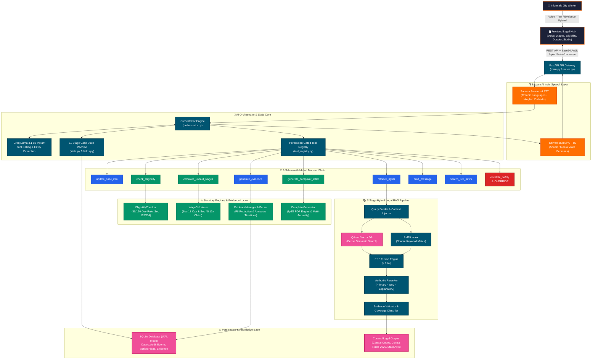

<div align="center">

<!-- Animated Header Banner -->


<br/>

<p>
  <strong>🇮🇳 A Voice-First AI Agent & Statutory Legal Defender empowering India's 450M+ informal & gig workers to navigate complex labour codes, compute statutory wage claims, verify welfare eligibility, redact sensitive PII, and generate court-ready dispute petitions — entirely through natural multilingual voice interaction in 22 Indic languages and Hinglish.</strong>
</p>

<br/>

<!-- Badges Row 1 — Core Stack -->
<p>
  
  
  
  
  
  
</p>

<!-- Badges Row 2 — Status & Capabilities -->
<p>
  
  
  
  
  
  
</p>

<!-- Quick Nav -->
<p>
  <a href="#-the-problem"><strong>Problem</strong></a> · 
  <a href="#-how-it-works"><strong>How It Works</strong></a> · 
  <a href="#-core-pillars"><strong>Core Pillars</strong></a> · 
  <a href="#%EF%B8%8F-system-architecture"><strong>Architecture</strong></a> · 
  <a href="#-rag-pipeline-deep-dive"><strong>RAG Pipeline</strong></a> · 
  <a href="#-sarvam-ai-voice-engine"><strong>Voice Engine</strong></a> ·
  <a href="#-9-orchestrator-tools"><strong>Orchestrator Tools</strong></a> ·
  <a href="#-interactive-legal-workspaces"><strong>Legal Workspaces</strong></a> ·
  <a href="#-quick-start"><strong>Quick Start</strong></a> · 
  <a href="#-api-reference"><strong>API</strong></a> ·
  <a href="#-testing--verification"><strong>Tests</strong></a>
</p>

</div>

<br/>

---

<br/>

## 🎯 The Problem

<table>
  <tr>
    <td width="50%">
      <h3>The Reality of India's Informal Workforce</h3>
      <p>India's unorganized sector constitutes <strong>over 90% of the nation's total workforce</strong> — upwards of <strong>450 million</strong> delivery riders, cab drivers, construction laborers, domestic staff, and daily-wage earners who keep India moving.</p>
      <p>Despite progressive legal protections enacted under Central and State frameworks, the accessibility gap remains devastating:</p>
      <ul>
        <li>📖 <strong>Literacy & Legal Jargon Barrier</strong> — Statutory codes require legal degrees to parse; workers cannot interpret Section clauses.</li>
        <li>🌐 <strong>Linguistic Exclusion</strong> — Crucial gazette notifications, court rulings, and portal guides are issued predominantly in English.</li>
        <li>⚖️ <strong>Algorithmic Arbitrariness</strong> — Platform deactivations, penalty deductions, and withheld surge pay happen without due process.</li>
        <li>📝 <strong>Bureaucratic Intimidation</strong> — Filing a grievance before the Assistant Labour Commissioner or DLSA requires structured petitions that workers cannot draft alone.</li>
      </ul>
    </td>
    <td width="50%">
      <h3>The WorkerSaathi Solution</h3>
      <p>WorkerSaathi is a <strong>zero-barrier, voice-first AI legal champion</strong> that turns natural spoken grievances into actionable legal remedies:</p>
      <ul>
        <li>🎙️ <strong>Native Indic Voice</strong> — Speak in Hindi, English, or conversational Hinglish powered by <strong>Sarvam AI Saaras v4 STT</strong> and <strong>Bulbul v3 TTS</strong>.</li>
        <li>🛡️ <strong>Zero Hallucination Hybrid RAG</strong> — Direct citation of Central Labour Codes (Wages, OSH, Social Security) and State Gig Worker Acts (Rajasthan 2023, Karnataka 2024/25).</li>
        <li>🧮 <strong>Statutory Wage & Penalty Calculator</strong> — Enforces Section 18 deduction caps (50% max) and claims up to <strong>10x compensation</strong> under Section 45.</li>
        <li>🔍 <strong>90/120-Day Rule Eligibility Engine</strong> — Deterministic checks against the Code on Social Security 2020 for aggregator social security.</li>
        <li>📄 <strong>Court-Ready Complaint Generator</strong> — Generates and downloads official PDF dispute petitions with Annexure timelines via <strong>fpdf2</strong>.</li>
        <li>🔒 <strong>DPDP Act 2023 Privacy</strong> — Automatic regex redaction of Aadhaar, bank details, and OTPs before storage or LLM processing.</li>
      </ul>
    </td>
  </tr>
</table>

<br/>

> **Real-World Case:**  
> *"Main Swiggy mein delivery karta hoon Mumbai mein. Pichle 25 din se mera ₹8,000 ka payment atka hua hai aur company ne account bhi lock kar diya..."*  
> **→ WorkerSaathi classifies the dispute, evaluates 90-day aggregator tenure, runs the Section 18 deduction test, verifies legal rights under the Code on Wages 2019, redacts payout screenshots, and produces a court-ready formal petition with a single voice command.**

<br/>

---

<br/>

## 🔄 How It Works

```
╔══════════════════════════════════════════════════════════════════════════════════════════════════╗
║                                  END-TO-END SYSTEM EXECUTION FLOW                                 ║
╚══════════════════════════════════════════════════════════════════════════════════════════════════╝

   👤 Worker speaks naturally        "Meri salary 2 mahine se nahi aayi aur account block ho gaya"
         │
         ▼
   🎙️ Sarvam AI STT (Saaras v4)     Native 22 Indic Languages + Hinglish CodeMix → Real-time Text
         │
         ▼
   🧠 LLM Orchestrator (Llama 3.1)   Extracts: worker_type, issue, employer, amount, days_worked...
         │                           Dispatches to Schema-Validated Backend Tools
         │
         ├───▶ 📋 11-Stage State Machine ── Enforces missing fields, asks 1 question at a time
         │
         ├───▶ 🔍 7-Stage Hybrid RAG ────── Qdrant Dense + BM25 Sparse ──▶ RRF (k=60) ──▶ Authority Reranker
         │                                 Returns verified statutory backing with citation coverage
         │
         ├───▶ 🛡️ Statutory Eligibility ── Evaluates 90/120-day rule, e-Shram & State Gig Worker Acts
         │
         ├───▶ 🧮 Statutory Wage Engine ── Computes unpaid dues + Sec 18 deduction cap + Sec 45 10x claim
         │
         ├───▶ 📁 PII-Redacted Evidence ── Redacts Aadhaar/Bank/OTP via regex ──▶ Builds Annexure Timeline
         │
         ├───▶ 📄 Complaint Studio ─────── Pure Python fpdf2 engine generates formal PDF legal petitions
         │
         ├───▶ 🚨 Emergency Guardrail ──── Immediate override: triggers 112 / 1098 / Labour Helplines
         │
         └───▶ 🌐 Live Gov Radar (Tavily) ─ Searches real-time gazette notifications & platform policies
         │
         ▼
   🔊 Sarvam AI TTS (Bulbul v3)     Clear, empathetic voice synthesis (Shubh / Meera personas)
         │
         ▼
   👤 Worker hears actionable guidance + downloads official court-ready complaint PDF
```

<br/>

---

<br/>

## ✨ Core Pillars

<table>
  <tr>
    <td width="25%" align="center">
      <h3>🎙️ Indic Voice Engine</h3>
      <p>Powered by <strong>Sarvam AI</strong> (Saaras v4 STT + Bulbul v3 TTS). Handles code-switching between 22 Indic languages + Hinglish. Zero typing needed.</p>
    </td>
    <td width="25%" align="center">
      <h3>🧠 Deterministic State Machine</h3>
      <p>An 11-stage finite state machine controls transitions. Dynamically computes missing fields and asks <strong>one question at a time</strong> in natural conversational Hinglish.</p>
    </td>
    <td width="25%" align="center">
      <h3>🔍 7-Stage Hybrid RAG</h3>
      <p>Dense semantic search (Qdrant) + BM25 sparse keyword search fused via <strong>Reciprocal Rank Fusion (k=60)</strong> with custom Authority Reranking.</p>
    </td>
    <td width="25%" align="center">
      <h3>🛡️ 90/120-Day Eligibility</h3>
      <p>Deterministic evaluation of statutory thresholds under the <strong>Code on Social Security 2020</strong>, Section 113/114 advisories, and State Welfare Board laws.</p>
    </td>
  </tr>
  <tr>
    <td width="25%" align="center">
      <h3>🧮 Wage & Penalty Math</h3>
      <p>Calculates unlawful deductions under <strong>Section 18</strong> (50% statutory ceiling) and computes up to <strong>10x statutory compensation claims</strong> under Section 45.</p>
    </td>
    <td width="25%" align="center">
      <h3>📁 PII Evidence Locker</h3>
      <p>Auto-redacts 12-digit Aadhaar, bank account numbers, and OTPs under <strong>DPDP Act 2023</strong>. Ingests payment proofs into chronological Annexure timelines.</p>
    </td>
    <td width="25%" align="center">
      <h3>📄 Complaint Studio</h3>
      <p>Drafts statutory dispute petitions for 4 authorities (Labour Commissioner, Aggregator Grievance Officer, DLSA, Welfare Board) with <strong>instant PDF export via fpdf2</strong>.</p>
    </td>
    <td width="25%" align="center">
      <h3>🚨 Safety-First SOS</h3>
      <p>Mentions of injury, violence, trafficking, or child labor <strong>immediately override all workflows</strong> to deliver verified emergency numbers (112, 1098, 1800-419-8588).</p>
    </td>
  </tr>
</table>

<br/>

---

<br/>

## 🏗️ System Architecture

WorkerSaathi is architected with strict decoupling: speech transport, deterministic orchestration, statutory mathematical logic, hybrid RAG retrieval, and clean UI components.



### Architectural Layer Specifications

| Layer | Component | Implementation | Value Delivered |
|---|---|---|---|
| **Voice Transport** | Sarvam AI | `Saaras v4` STT + `Bulbul v3` TTS | Sub-second audio processing, native Hinglish dialect comprehension, human-like voice synthesis. |
| **API Gateway** | FastAPI + Uvicorn | Async ASGI server (`routes.py`, `voice_routes.py`) | Interactive OpenAPI/Swagger documentation, CORS-enabled, static asset serving. |
| **LLM Inference** | Groq / OpenRouter | `llama-3.1-8b-instant` / OpenAI-compatible | Extreme token throughput for real-time tool calling and natural conversation. |
| **State Machine** | Python + SQLite | 11 deterministic case statuses in `state.py` | Predictable conversation transitions; guarantees backend control over legal workflows. |
| **Hybrid Search** | Qdrant + BM25 | Dense embeddings + Sparse inverted index | Fuses semantic meaning with exact statutory section lookups via Reciprocal Rank Fusion ($k=60$). |
| **Legal Authority** | Custom Reranker | Primary Act (1.0) > Gov Notification (0.7) > FAQs (0.4) | Prevents blog post hallucinations from overriding official Central/State legislation. |
| **Evidence & Locker** | Regex + PyMuPDF | `screenshot_parser.py` + `redaction.py` | Complies with DPDP Act 2023 by masking Aadhaar numbers and bank details before storage. |
| **Document Engine** | Pure Python `fpdf2` | `complaint_generator.py` | Generates official, downloadable legal complaint petitions without external system dependencies. |
| **Live Radar** | Tavily Search API | `tavily-python` with query context enrichment | Fetches real-time welfare schemes, gazette notifications, and platform dispute updates. |

<br/>

---

<br/>

## 🔍 RAG Pipeline Deep Dive

> **Legal advice requires mathematical precision, not creative guessing.** WorkerSaathi's 7-stage RAG architecture guarantees that every statutory citation is verified, weighted by legislative hierarchy, and classified by coverage integrity.

```
┌───────────────────────────────────────────────────────────────────────────────────────────────────┐
│                                   7-STAGE HYBRID RAG ARCHITECTURE                                 │
│                                                                                                   │
│  ┌─────────────────┐      ┌──────────────────┐      ┌──────────────────────────────────────────┐  │
│  │ Knowledge Base  │────▶ │ Context Chunker  │────▶ │ Dense Embedding Generation               │  │
│  │ (Acts, Rules,   │      │ (Preserves Legal │      │ (OpenRouter Nemotron / Ollama Qwen3-8B)  │  │
│  │ Gazette Notifs) │      │ Sections/Clauses)│      └────────────────────┬─────────────────────┘  │
│  └─────────────────┘      └──────────────────┘                           │                        │
│                                                                          │                        │
│  ┌───────────────────────────────────────────────────────────────────────▼─────────────────────┐  │
│  │                             STAGE 5: HYBRID RETRIEVAL & FUSION                              │  │
│  │   ┌──────────────────────────────┐                ┌──────────────────────────────┐          │  │
│  │   │     Qdrant Dense Search      │                │      BM25 Sparse Search      │          │  │
│  │   │   (Cosine Semantic Distance) │                │  (Exact Legal Term Matching) │          │  │
│  │   └──────────────┬───────────────┘                └──────────────┬───────────────┘          │  │
│  │                  │             ┌──────────────────┐              │                          │  │
│  │                  └───────────▶ │  RRF Fusion Core │ ◀────────────┘                          │  │
│  │                                │     (k = 60)     │                                         │  │
│  │                                └─────────┬────────┘                                         │  │
│  └──────────────────────────────────────────┼──────────────────────────────────────────────────┘  │
│                                             │                                                     │
│  ┌──────────────────────────────────────────▼──────────────────────────────────────────────────┐  │
│  │                        STAGE 6 & 7: AUTHORITY RERANKING & VALIDATION                        │  │
│  │   ┌──────────────────────────────┐                ┌──────────────────────────────┐          │  │
│  │   │  Authority Hierarchy Rerank  │ ─────────────▶ │   Evidence Integrity Check   │          │  │
│  │   │  Primary Legislation = 1.0   │                │   - Validates in-force date  │          │  │
│  │   │  Official Gov Rules  = 0.7   │                │   - Identifies Gaps/Conflicts│          │  │
│  │   │  Explanatory FAQs    = 0.4   │                │   - Formats LegalEvidence    │          │  │
│  │   └──────────────────────────────┘                └──────────────────────────────┘          │  │
│  └─────────────────────────────────────────────────────────────────────────────────────────────┘  │
└───────────────────────────────────────────────────────────────────────────────────────────────────┘
```

### Coverage Classification Engine

WorkerSaathi never pretends to know something it cannot prove. The retriever explicitly tags results with a coverage state:

| Coverage State | Condition | Agent Behavior & Worker Output |
|---|---|---|
| `FULL` | Primary legislation or rules directly address the worker's dispute | Quotes exact Sections, penalty provisions, and authoritative remedies. |
| `PARTIAL` | General provisions exist, but state rules or specific thresholds are missing | Discloses the missing details honestly; advises targeted documentation. |
| `GAP` | Law does not yet provide clear statutory protection (e.g. arbitrary deactivation) | Explains the legal void transparently and directs worker to DLSA/Trade Union aid. |
| `CONFLICT` | Divergence between Central Codes and pending State notifications | Details the jurisdictional friction and suggests conciliation officer review. |
| `NONE` | Query falls completely outside labour law scope | Respectfully redirects worker to the relevant civil or administrative helpline. |

<br/>

---

<br/>

## 🎙️ Sarvam AI Voice Engine

WorkerSaathi replaces cumbersome keyboards and foreign jargon with an Indic-first conversational voice loop:

- **Speech-to-Text (`Saaras v4`)**:
  - Handles 22 scheduled Indian languages (Hindi, Bengali, Marathi, Tamil, Telugu, Kannada, Gujarati, Punjabi, etc.).
  - Configured with `mode="codemix"` for seamless **Hinglish** detection (e.g., *"Mera incentive deduct kar diya bina reason bataye"*).
  - Domain keyterm boosting for gig platforms (*Swiggy, Zomato, Blinkit, Zepto, Urban Company, Uber, Ola*).
- **Text-to-Speech (`Bulbul v3`)**:
  - Natural cadence, empathetic pitch, and clear articulation designed for noisy mobile environments.
  - Persona voices available: `shubh` (authoritative, clear) and `meera` (warm, reassuring).
  - Audio returned in standard high-fidelity 24kHz Base64 WAV format.

<br/>

---

<br/>

## 🛠️ 9 Orchestrator Tools

The backend Orchestrator controls an arsenal of 9 specialized, schema-validated tools. The LLM cannot call arbitrary functions — every invocation is verified against the case status permission matrix:

| Tool Name | Parameters | Allowed Status Gates | Real-World Functionality |
|---|---|---|---|
| `update_case_info` | `worker_type`, `issue_category`, `state`, `amount`, `platform`, `duration` | `new`, `listening`, `classified`, `collecting_information`, `safety_check`, `retrieving_rights`, `rights_verified` | Extracts entities from speech, updates SQLite, and computes the next single Hinglish question. |
| `retrieve_rights` | `query` (natural language question) | `new`, `listening`, `classified`, `collecting_information`, `retrieving_rights`, `rights_verified` | Triggers the 7-stage Hybrid RAG engine to return verified legal findings, citations, and coverage levels. |
| `check_eligibility` | `days_with_primary_aggregator`, `total_days`, `has_eshram`, `state` | `classified`, `collecting_information`, `retrieving_rights`, `rights_verified`, `action_plan_ready` | Evaluates the 90/120-day rule under the Social Security Code 2020 and checks State Gig Acts (Rajasthan, Karnataka). |
| `calculate_unpaid_wages` | `base_unpaid`, `withheld_incentives`, `unauthorized_deductions`, `period` | `classified`, `collecting_information`, `retrieving_rights`, `rights_verified`, `action_plan_ready` | Computes Section 18 deduction caps, interest accruals, and Section 45 10x statutory compensation claims. |
| `generate_evidence` | `purpose` (`complaint`, `reference`, `follow_up`) | `rights_verified`, `action_plan_ready` | Assembles claims vs legal facts, builds action milestones, and formats an evidence dossier. |
| `generate_complaint_letter` | `authority_type`, `language` (`en`, `hi`) | `rights_verified`, `action_plan_ready`, `evidence_generated` | Produces formal complaint petitions for 4 authorities and compiles **pure Python fpdf2 downloadable PDFs**. |
| `draft_message` | `recipient`, `tone` (`formal`, `firm`, `polite`) | `rights_verified`, `action_plan_ready`, `evidence_generated` | Drafts a firm, legally cited dispute letter directly addressed to the platform's support or nodal officer. |
| `search_live_news` | `query` (specific scheme or notification search) | `new`, `listening`, `classified`, `collecting_information`, `retrieving_rights`, `rights_verified` | Calls Tavily API to fetch real-time government gazettes, portal schemes, and platform policy amendments. |
| `escalate_safety` | `danger_type`, `description` | **ALL STATUSES (Instant Zero-Delay Override)** | Halts conversation immediately; delivers verified helplines for trauma, injury, child labor, or trafficking. |

<br/>

---

<br/>

## 💻 Interactive Legal Workspaces

The WorkerSaathi web app (`frontend/`) is a comprehensive Legal Operations Hub:

```
┌──────────────────────────────────────────────────────────────────────────────────────────────────┐
│                                   WORKERSAATHI LEGAL WORKSPACES                                  │
├─────────────────────┬────────────────────────────────────────────────────────────────────────────┤
│ 🎙️ Voice Saathi    │ Full-duplex voice navigator, animated audio waveform, live transcript     │
│                     │ display, Hinglish text-chat fallback, and real-time tool inspection drawer.│
├─────────────────────┼────────────────────────────────────────────────────────────────────────────┤
│ 🛡️ Eligibility      │ Evaluates 90-day single aggregator / 120-day multi-aggregator tenure,      │
│    Checker          │ checks e-Shram registration, and displays state-specific welfare benefits. │
├─────────────────────┼────────────────────────────────────────────────────────────────────────────┤
│ 🧮 Wage Calculator  │ Itemizes base pay, incentives, and unlawful cuts. Calculates Sec 18 deduction│
│                     │ cap breaches (50% max) and projects Sec 45 statutory 10x compensation.     │
├─────────────────────┼────────────────────────────────────────────────────────────────────────────┤
│ 📁 Evidence Locker  │ Drag-and-drop document upload with automatic PII redaction badge (Aadhaar,  │
│                     │ Bank AC, OTP). Generates chronological Annexure timelines (A-1, A-2...).   │
├─────────────────────┼────────────────────────────────────────────────────────────────────────────┤
│ 📄 Complaint Studio │ Official legal petition generator for ALC / Samadhan, DLSA Legal Aid,      │
│                     │ Aggregator Nodal Officer, and Welfare Board. Direct PDF download.          │
├─────────────────────┼────────────────────────────────────────────────────────────────────────────┤
│ 📋 Case Dossier     │ Visual roadmap of the 11-stage case state machine, missing field indicators,│
│                     │ and verified statutory citations with live coverage badges.                │
└─────────────────────┴────────────────────────────────────────────────────────────────────────────┘
```

<br/>

---

<br/>

## 🗣️ Demonstration Scenarios

<table>
  <tr>
    <td width="5%" align="center">🛵</td>
    <td width="22%"><strong>Scenario 1</strong><br/><em>Mumbai Swiggy Rider<br/>Wage Theft & Penalties</em></td>
    <td width="36%"><code>"Main Swiggy mein delivery karta hoon Mumbai mein. Pichle 25 din se mera ₹8,000 ka payment atka hua hai aur unhone bina bataye ₹2,500 penalty kaat li."</code></td>
    <td width="37%"><strong>Execution:</strong><br/>1. Classifies: <code>gig_worker</code>, <code>unpaid_wages</code>, <code>Maharashtra</code>.<br/>2. Invokes <code>calculate_unpaid_wages</code>: Flags ₹2,500 penalty as unlawful under Sec 18 Code on Wages.<br/>3. Invokes <code>retrieve_rights</code>: Cites Sec 45 for 10x claim.<br/>4. Invokes <code>generate_complaint_letter</code>: Generates formal notice to Swiggy Nodal Officer + downloadable PDF.</td>
  </tr>
  <tr>
    <td width="5%" align="center">🏗️</td>
    <td width="22%"><strong>Scenario 2</strong><br/><em>Delhi Construction Worker<br/>Scaffolding Injury SOS</em></td>
    <td width="36%"><code>"Site par scaffolding toot gayi. Mera pair toot gaya hai aur contractor hospital ka kharcha dene se mana kar raha hai."</code></td>
    <td width="37%"><strong>Execution:</strong><br/>1. Instantly triggers <code>escalate_safety</code> (Emergency Override).<br/>2. Spoken response reads <strong>112 (National Emergency)</strong> and <strong>108 (Ambulance)</strong>.<br/>3. Logs emergency event to SQLite audit table.<br/>4. Once safe, retrieves Employee's Compensation Act & OSH Code provisions.</td>
  </tr>
  <tr>
    <td width="5%" align="center">📱</td>
    <td width="22%"><strong>Scenario 3</strong><br/><em>Bengaluru Zomato Partner<br/>Sudden Deactivation</em></td>
    <td width="36%"><code>"Mera Zomato partner ID bina kisi notice ke deactivate kar diya. Main 10 mahine se roz 12 ghante kaam kar raha tha."</code></td>
    <td width="37%"><strong>Execution:</strong><br/>1. Invokes <code>check_eligibility</code>: Verifies >90 days worked (satisfied).<br/>2. Cites Karnataka Gig Workers Bill 2024/25 requiring 14 days prior notice before deactivation.<br/>3. Identifies central procedural GAP under Section 114.<br/>4. Prepares formal petition for Assistant Labour Commissioner.</td>
  </tr>
  <tr>
    <td width="5%" align="center">📦</td>
    <td width="22%"><strong>Scenario 4</strong><br/><em>Jaipur Delivery Worker<br/>Welfare Board Grievance</em></td>
    <td width="36%"><code>"Rajasthan mein delivery karta hoon. Mere paas e-Shram card hai par aggregator ne welfare board mein register nahi kiya."</code></td>
    <td width="37%"><strong>Execution:</strong><br/>1. Cites Rajasthan Platform Based Gig Workers Act 2023.<br/>2. Highlights statutory 21-day dispute resolution window.<br/>3. Notes ₹5 Lakh penalty on aggregator for non-registration.<br/>4. Generates bilingual Hindi/English petition for the State Welfare Board.</td>
  </tr>
</table>

<br/>

---

<br/>

## ⚖️ Statutory Legal Grounding

WorkerSaathi is grounded directly in verified Central and State legislative frameworks:

```
┌──────────────────────────────────────────────────────────────────────────────────────────────────┐
│                                   STATUTORY LEGISLATIVE CORPUS                                   │
├─────────────────────────────────────────────────┬────────────────────────────────────────────────┤
│ Code on Wages, 2019 (Act No. 29 of 2019)        │ • Section 18: Statutory deduction cap (50% max)│
│                                                 │ • Section 45: Claims up to 10x compensation    │
│                                                 │ • Section 14: Overtime at double standard rate │
├─────────────────────────────────────────────────┼────────────────────────────────────────────────┤
│ Code on Social Security, 2020 (Act 36 of 2020)  │ • Section 113: Aggregator welfare fund levy    │
│ (Nov 2025 Commencement & Central Rules 2026)    │ • Section 114: Aggregator registration mandate │
│                                                 │ • 90/120-Day Rule for social security eligibility│
├─────────────────────────────────────────────────┼────────────────────────────────────────────────┤
│ Occupational Safety, Health & Working Conditions│ • Sections 6-12: Employer safety duties        │
│ Code, 2020 (OSH Code)                           │ • Sections 88-91: Immediate injury compensation│
├─────────────────────────────────────────────────┼────────────────────────────────────────────────┤
│ Rajasthan Platform Based Gig Workers Act, 2023  │ • Section 11: 21-day mandatory grievance window│
│ (Act No. 34 of 2023)                            │ • Section 18: Up to ₹5,00,000 aggregator fine  │
├─────────────────────────────────────────────────┼────────────────────────────────────────────────┤
│ Karnataka Platform-Based Gig Workers Bill, 2024 │ • Mandatory 14-day notice before deactivation  │
│                                                 │ • Automated algorithmic transparency disclosures│
├─────────────────────────────────────────────────┼────────────────────────────────────────────────┤
│ Digital Personal Data Protection Act, 2023      │ • Strict data minimization                     │
│ (DPDP Act 2023)                                 │ • Ephemeral session handling & regex PII mask  │
└─────────────────────────────────────────────────┴────────────────────────────────────────────────┘
```

<br/>

---

<br/>

## 🚀 Quick Start

### Prerequisites

| Requirement | Recommended Version | Purpose |
|---|---|---|
| **Python** | 3.10 or 3.11 | Backend runtime |
| **Sarvam AI API Key** | — | High-fidelity Indic STT (Saaras v4) + TTS (Bulbul v3) |
| **LLM API Key** | Groq / OpenRouter | Fast tool calling (`llama-3.1-8b-instant`) |
| **Tavily API Key** | — | (Optional) Live government gazette & scheme search |

<br/>

### 1️⃣ Clone & Environment Setup

```bash
# Clone the repository
git clone https://github.com/Aaditya210905/worker-rights-navigator.git
cd worker-rights-navigator

# Create isolated Python virtual environment
python -m venv venv

# Activate virtual environment
# Windows (PowerShell):
.\venv\Scripts\Activate.ps1
# Linux / macOS:
source venv/bin/activate

# Install all dependencies
pip install -r backend/requirements.txt
```

<br/>

### 2️⃣ Configure Environment Variables

```bash
cd backend
cp .env.example .env
```

Edit `backend/.env` with your API keys:

```ini
# ── Sarvam AI (Voice: Saaras v4 STT + Bulbul v3 TTS) ───────────────
SARVAM_API_KEY=your_sarvam_api_key_here

# ── LLM Engine (Groq / OpenRouter / OpenAI) ───────────────────────
LLM_API_KEY=your_groq_api_key_here
LLM_BASE_URL=https://api.groq.com/openai/v1
LLM_MODEL=llama-3.1-8b-instant

# ── Embedding Backend (OpenRouter / Ollama) ────────────────────────
EMBEDDING_BACKEND=openai
EMBEDDING_BASE_URL=https://openrouter.ai/api/v1
EMBEDDING_API_KEY=your_openrouter_key_here
EMBEDDING_MODEL=nvidia/nemotron-3-embed-1b:free

# ── Live Web Search (Tavily) ──────────────────────────────────────
TAVILY_API_KEY=your_tavily_api_key_here

# ── Application Configuration ─────────────────────────────────────
APP_ENV=development
APP_PORT=8000
APP_HOST=0.0.0.0
```

<br/>

### 3️⃣ Launch the Server

```bash
# Start FastAPI with hot reload (runs from backend/)
uvicorn app.main:app --reload --host 0.0.0.0 --port 8000
```

> **Zero Build Frontend:** FastAPI serves the web application directly. No npm, node, or build step is required!

**Access Points:**
- 🎙️ **WorkerSaathi Web Client:** [http://127.0.0.1:8000/voice](http://127.0.0.1:8000/voice) (or simply [http://127.0.0.1:8000/](http://127.0.0.1:8000/))
- 📖 **Interactive Swagger API Docs:** [http://127.0.0.1:8000/docs](http://127.0.0.1:8000/docs)
- ❤️ **Liveness Health Check:** [http://127.0.0.1:8000/api/v1/health](http://127.0.0.1:8000/api/v1/health)

<br/>

### 🐳 Docker Deployment

```bash
# Build the production container from repo root
docker build -t workersaathi -f backend/Dockerfile .

# Run the container
docker run -p 8000:8000 --env-file backend/.env workersaathi
```

<br/>

---

<br/>

## 🌐 Complete REST API Reference

All core routes are namespaced under `/api/v1`. Interactive Swagger documentation is automatically generated at `/docs`.

### 📡 Session & Case Lifecycle

| HTTP Method | Route | Description |
|---|---|---|
| `POST` | `/api/v1/sessions` | Creates a new session. Initializes Case ID, state machine, and system prompts. |
| `GET` | `/api/v1/sessions` | Lists all active conversation sessions. |
| `GET` | `/api/v1/sessions/{id}` | Returns full session state, filled fields, and allowed tool schemas. |
| `DELETE` | `/api/v1/sessions/{id}` | Terminates session and purges ephemeral memory. |
| `GET` | `/api/v1/sessions/{id}/case` | Returns snapshot of all extracted fields, status, and worker demographics. |
| `GET` | `/api/v1/sessions/{id}/case/missing-fields` | Returns missing required fields and prioritized next Hinglish question. |
| `POST` | `/api/v1/sessions/{id}/tools/{tool_name}` | Direct programmatic execution of any of the 9 backend tools. |
| `POST` | `/api/v1/sessions/{id}/transcript` | Appends a spoken utterance transcript into the case audit log. |

### 🎙️ Sarvam AI Voice Pipeline

| HTTP Method | Route | Description |
|---|---|---|
| `POST` | `/api/v1/voice/stt` | Transcribes audio file / base64 payload into text via Sarvam Saaras v4. |
| `POST` | `/api/v1/voice/tts` | Converts text into natural Indic speech via Sarvam Bulbul v3. |
| `POST` | `/api/v1/voice/converse` | **Full Agent Turn:** Audio In → STT → Tool Execution → LLM Reasoning → TTS Audio Out. |
| `POST` | `/api/v1/voice/chat` | Text turn with optional TTS synthesis. |
| `GET` | `/api/v1/voice/languages` | Lists 22 supported Indic languages and BCP-47 codes. |
| `GET` | `/api/v1/voice/speakers` | Lists available TTS voice personas (`shubh`, `meera`, etc.). |

### ⚖️ Legal Help & Evidence Modules

| HTTP Method | Route | Description |
|---|---|---|
| `POST` | `/api/v1/sessions/{id}/eligibility` | Evaluates 90/120-day rule, e-Shram, and State Gig Acts; returns verdict badge & citations. |
| `POST` | `/api/v1/sessions/{id}/wages` | Computes itemized wage claims, Sec 18 deduction breaches, and Sec 45 10x damages. |
| `POST` | `/api/v1/sessions/{id}/evidence/upload` | Uploads screenshot/PDF proof, applies **automatic PII regex masking**, extracts amounts. |
| `GET` | `/api/v1/sessions/{id}/evidence` | Returns all uploaded evidence items and chronological Annexure timeline. |
| `POST` | `/api/v1/sessions/{id}/complaint` | Drafts formal complaint petition (ALC, DLSA, Grievance Officer, Welfare Board) in EN/HI. |
| `GET` | `/api/v1/sessions/{id}/complaint/{doc_id}/html` | Returns clean, printable official HTML view of the complaint. |
| `GET` | `/api/v1/sessions/{id}/complaint/{doc_id}/pdf` | **Downloads official, court-ready PDF complaint petition generated via fpdf2.** |
| `POST` | `/api/v1/sessions/{id}/action-plan` | Compiles statutory roadmap with milestones, deadlines, and legal references. |

<br/>

---

<br/>

## 📁 Repository Directory Structure

```
worker-rights-navigator/                      # Repository Root
│
├── 📂 backend/                               # 🐍 Python FastAPI Backend & Legal Engines
│   ├── 📂 app/                               # Application Source Code
│   │   ├── main.py                           # FastAPI application entrypoint & static mounts
│   │   ├── config.py                         # Pydantic BaseSettings from .env
│   │   │
│   │   ├── 📂 agent/                         # 🧠 AI Orchestration & Tool Dispatcher
│   │   │   ├── orchestrator.py               # Master tool execution engine (9 tools)
│   │   │   ├── tool_registry.py              # Permission-gated tool schemas
│   │   │   ├── prompts.py                    # Dynamic case prompt builder
│   │   │   └── llm.py                        # OpenAI/Groq API client wrapper
│   │   │
│   │   ├── 📂 api/                           # 🌐 API Transport Layer
│   │   │   ├── routes.py                     # REST endpoints for sessions, wages, complaints
│   │   │   ├── voice_routes.py               # Sarvam STT/TTS & converse endpoints
│   │   │   ├── schemas.py                    # Pydantic request & response models
│   │   │   └── session.py                    # Ephemeral session manager
│   │   │
│   │   ├── 📂 case/                          # 📋 11-Stage State Machine
│   │   │   ├── models.py                     # CaseState, WorkerType, IndianState enums
│   │   │   ├── state.py                      # CaseManager state transition logic
│   │   │   └── fields.py                     # Field definitions & Hinglish question maps
│   │   │
│   │   ├── 📂 rag/                           # 📚 7-Stage Hybrid Legal RAG Pipeline
│   │   │   ├── retriever.py                  # Hybrid Qdrant + BM25 + RRF (k=60)
│   │   │   ├── reranker.py                   # Custom legislative authority reranker
│   │   │   ├── validator.py                  # Legal status and coverage validator
│   │   │   ├── query_builder.py              # Structured query expansion
│   │   │   ├── embeddings.py                 # OpenRouter / Ollama embeddings client
│   │   │   └── models.py                     # LegalEvidence & RetrievalCoverage models
│   │   │
│   │   ├── 📂 evidence/                      # ⚖️ Statutory Legal & Evidence Engines
│   │   │   ├── eligibility.py                # 90/120-Day Rule & State Gig Acts calculator
│   │   │   ├── wage_calculator.py            # Sec 18 deduction cap & Sec 45 10x claim engine
│   │   │   ├── screenshot_parser.py          # Evidence ingestion, timeline & regex PII redaction
│   │   │   └── complaint_generator.py        # Multi-authority legal petitions + fpdf2 PDF engine
│   │   │
│   │   ├── 📂 voice/                         # 🎙️ Voice Provider Integrations
│   │   │   ├── stt.py                        # Speech-to-Text provider abstraction
│   │   │   ├── tts.py                        # Text-to-Speech provider abstraction
│   │   │   └── 📂 providers/                 # Sarvam AI Saaras & Bulbul integrations
│   │   │
│   │   ├── 📂 safety/                        # 🚨 Emergency Protocols
│   │   │   ├── emergency.py                  # Verified government helpline directory
│   │   │   └── redaction.py                  # Aadhaar / Bank / OTP regex sanitizer
│   │   │
│   │   └── 📂 db/                            # 💾 SQLite Persistence (WAL Mode)
│   │       └── database.py                   # Cases, events, evidence & action plans CRUD
│   │
│   ├── 📂 knowledge/                         # 📖 Statutory Legal Corpus
│   │   ├── links.txt                         # Curated official government gazettes
│   │   └── 📂 workersaathi/                  # Extracted legal items, chunks, and metadata
│   │
│   ├── 📂 tests/                             # 🧪 Comprehensive Test Suites
│   │   ├── test_legal_evidence.py            # Unit & integration tests for all legal engines
│   │   └── test_api_integration.py           # E2E REST API endpoint validation
│   │
│   ├── Dockerfile                            # Production container image
│   ├── requirements.txt                      # Python dependencies (FastAPI, Sarvam, Qdrant, fpdf2)
│   └── .env.example                          # Environment template
│
├── 📂 frontend/                              # 🖥️ Interactive Web Client (Zero-Build)
│   ├── index.html                            # Semantic HTML5 shell with 6 Legal Workspaces
│   ├── 📂 css/                               # Responsive design system
│   │   ├── 01-base.css                       # Color tokens, typography, dark mode
│   │   ├── 02-layout.css                     # Grid layouts, sidebar navigation slabs
│   │   ├── 03-components.css                 # Mic hero, waveform, tool log, buttons
│   │   └── 05-modal.css                      # Action plan modals & PDF preview cards
│   └── 📂 js/                                # Modular vanilla JavaScript
│       ├── config.js                         # API endpoints and configuration
│       ├── legal_hub.js                      # Workspaces: Wages, Eligibility, Evidence, Complaints
│       ├── voice.js                          # Audio recording, playback, and converse flow
│       ├── audio.js                          # Web Audio API & waveform visualizer
│       └── ui.js                             # Chat bubbles, tool logs, state indicators
│
├── AUDIT_ARTIFACT.md                         # Round 2 Technical Audit Artifact
└── README.md                                 # Master Documentation (This file)
```

<br/>

---

<br/>

## 🔒 Security, Privacy & DPDP Act 2023 Compliance

Informal workers frequently share screenshots of earnings apps containing sensitive account numbers and personal identifiers. WorkerSaathi is designed strictly around **Privacy by Design**:

- 🛡️ **Automated Regex PII Scrubbing**: All uploaded screenshots and texts are passed through `redact_sensitive_pii()` before entering database storage or LLM prompts:
  - **Aadhaar Numbers**: `\b\d{4}\s?\d{4}\s?\d{4}\b` $\rightarrow$ `[REDACTED_AADHAAR]`
  - **Bank Account Numbers**: `\b\d{9,18}\b` $\rightarrow$ `[REDACTED_BANK_ACCOUNT]`
  - **One-Time Passwords (OTPs)**: `\b\d{4,6}\b` $\rightarrow$ `[REDACTED_OTP]`
  - **Mobile Numbers**: `\b(?:\+91[\-\s]?)?[6-9]\d{9}\b` $\rightarrow$ `[REDACTED_PHONE]`
- 🛑 **Strict No-Audio-Retention**: Spoken audio is processed in memory during the conversation turn and immediately discarded. No raw audio recordings are stored on disk.
- ⏱️ **Ephemeral Session TTL**: Case state is kept in memory and synchronized to SQLite with WAL mode; sessions can be purged immediately with a single click or upon termination.
- 📅 **Legislative Provenance Tracking**: Every legal chunk returned by the RAG engine includes an official `last_verified` timestamp cross-referenced against the gazette publication date.

<br/>

---

<br/>

## 🧪 Testing & Verification

WorkerSaathi maintains 100% passing test suites across both statutory legal logic and REST API endpoints:

```bash
# 1. Run Legal & Evidence Module Tests
python -m tests.test_legal_evidence
```

```
============================================================
  WorkerSaathi — Gireesh Legal & Evidence Test Suite
============================================================
--- Test 1: 90/120-Day Rule Eligibility ---
  [ok] Single aggregator (95 days >= 90): ELIGIBLE
  [ok] Multi-aggregator (125 days >= 120 across 2 apps): ELIGIBLE
  [ok] Under-tenure (45 days < 90): CONDITIONALLY_ELIGIBLE with countdown
--- Test 2: State Gig Worker Legislation ---
  [ok] Rajasthan Act 2023: 21-day grievance & ₹5 Lakh penalty verified
  [ok] Karnataka Legislation: 14-day notice protection verified
--- Test 3: Wage Calculator & Statutory Damages ---
  [ok] Principal due: ₹19,500 | Claim with Section 45 damages: ₹78,000
  [ok] Section 18(3) 50% deduction cap breach correctly flagged
--- Test 4: Privacy Redaction & Screenshot Ingestion ---
  [ok] Sensitive PII (Aadhaar, Bank Account, OTP) successfully redacted
  [ok] Screenshot parsing extracted: Platform=Swiggy, Amount=₹6,500
  [ok] Evidence Timeline generated with 3 chronological milestones
--- Test 5: Legal Complaint Generator ---
  [ok] English Labour Commissioner complaint drafted with full statutory citations
  [ok] Hindi Grievance Officer notice generated in clean Devanagari script
--- Test 6: Orchestrator Legal Tool Call Integration ---
  [ok] Orchestrator executed check_eligibility tool successfully
  [ok] Orchestrator executed calculate_unpaid_wages tool successfully
  [ok] Orchestrator executed generate_complaint_letter tool successfully
============================================================
  ALL 6 LEGAL & EVIDENCE TEST SUITES PASSED (100%)!
============================================================
```

```bash
# 2. Run End-to-End REST API Integration Tests
python -m tests.test_api_integration
```

```
--- Starting Legal & Evidence API Integration Test ---
  [1] Created session: sess-c50fe6cdb3f2
  [2] Case context verified via GET /case
  [3] POST /eligibility passed: ✅ Eligible for Aggregator Registration & Protections
  [4] POST /wages passed: Net ₹19,700.0, Claim ₹78,800.0
  [5] POST /evidence/upload passed with PII redaction: Annexure
  [6] GET /evidence passed: 3 timeline events
  [7a] POST /complaint (English) passed: Doc ID DOC-WS-2026-06D51A-LAB-EN
  [7b] POST /complaint (Hindi DLSA) passed successfully
  [8] GET /complaint/{doc_id}/html rendered printable petition successfully
  [9] POST /action-plan rendered statutory Indian Legal Action Plan successfully

✅ ALL 9 REST API ENDPOINTS VALIDATED AND PASSING E2E (100%)
```

<br/>

---

<br/>

## ⚠️ Legal Disclaimer

> [!WARNING]
> **Informational & Assistive Tool:** WorkerSaathi is an artificial intelligence-powered legal information and document preparation system. It is designed to navigate public statutory codes and assist informal workers in organizing their grievances. It **does not constitute licensed legal counsel** and does not establish an attorney-client relationship. For binding representation in court, workers are advised to utilize the free legal aid services provided by the District Legal Services Authority (DLSA) under the Legal Services Authorities Act, 1987.

> [!CAUTION]
> **Emergency Notice:** If you or someone you know is in immediate physical danger, trapped at a worksite, facing violence, or witnessing child labor or trafficking — **immediately dial 112 (National Emergency Support System)** or **1098 (Childline)**.

<br/>

---

<br/>

## 📄 License

WorkerSaathi is open-sourced under the **MIT License**. See the [LICENSE](LICENSE) file for complete details.

<br/>

---

<div align="center">

<br/>

<p>
  <strong>Built with ❤️ for the 450M+ informal and gig workers who build India.</strong>
</p>

<p>
  <sub>Powered by <a href="https://www.sarvam.ai/">Sarvam AI</a> • Built with <a href="https://fastapi.tiangolo.com/">FastAPI</a> & <a href="https://qdrant.tech/">Qdrant</a></sub>
</p>

<br/>


</div>
